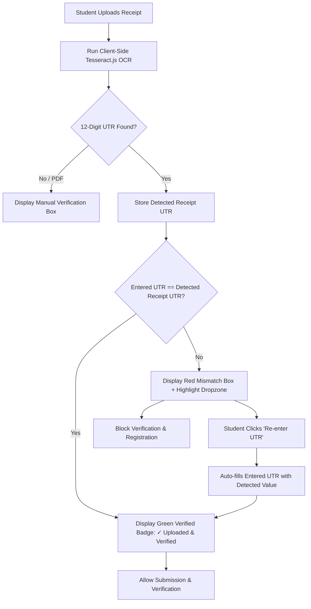

# Walkthrough: Payment UTR + Payment Receipt OCR Verification

## Overview
Successfully implemented and hardened the **Payment UTR + Payment Receipt OCR verification flow** in the Spheronix Hackathon Registration system, adhering strictly to the **Zero Database Changes** mandate.

---

## 1. Zero Database Changes Compliance Audit

| Requirement | Status | Verification Detail |
|---|---|---|
| **DATABASE SCHEMA CHANGED** | **NO** | No collections added, renamed, or modified. Existing document schemas intact. |
| **DATABASE INDEXES CHANGED** | **NO** | No indexes added, dropped, or modified. |
| **EXISTING DATABASE VALUES CHANGED** | **NO** | Zero modifications to existing records. Existing data is 100% read-only. |
| **EXISTING RECORDS MODIFIED** | **NO** | Existing records are read-only; startup `$unset` scripts neutralized in `initialize_async_collections()`. |
| **DATABASE MIGRATION RUN** | **NO** | No schema migrations executed. |

---

## 2. Key Components Implemented

### A. Configuration & Server-Side Fee Calculation
- **.env**: `DEFAULT_REGISTRATION_FEE=1`
- **config/settings.py**: Default fee set to `1.0`
- **app/services/settings_service.py**: Fallback fee set to `1.0`
- **app/models/schemas.py**: `feePerMember: float = 1.0` in `PaymentOrderResponse`
- **Fee Calculation**: Server dynamically computes `participant_count * fee_per_member` (e.g., 1 participant = ₹1, 4 members = ₹4) in both order generation and draft autosave.

### B. Database Safety Neutralization
- **app/database/mongodb.py**: `initialize_async_collections()` now issues a ping check and returns immediately, preventing legacy `$unset` and backfill scripts from modifying existing documents on server reboot.

### C. Backend Payment & Verification
- **app/services/payment_service.py**:
  - Validates 12-digit numeric UTR (`^\d{12}$`).
  - Read-only duplicate check for UTRs across confirmed registrations (`registrationCompleted: True`).
  - Strict fee recalculation on order generation.
- **app/services/registration_service.py**:
  - Implemented `resolve_receipt_storage(student, existing_doc)` to safely map receipt URL, base64, and filename.
- **app/routers/students.py**:
  - Validates 12-digit numeric UTR before finalizing registration.
  - Checks duplicate UTR against confirmed registrations.
  - Server-side validation rejecting submitted UTR if client OCR detected a valid 12-digit UTR that differs.
  - Added `paymentReceiptUrl`, `paymentReceiptBase64`, and `paymentReceiptName` in `/api/all-users-json`.
- **app/routers/payments.py**:
  - Magic byte binary signature validation for uploaded receipts (PNG, JPG, WEBP, PDF).
  - Maximum 5MB file size limit.

### D. Frontend OCR & State Machine
- **static/index.html**:
  - Loaded Tesseract.js v5 CDN (`tesseract.min.js`).
  - Receipt upload dropzone co-located in Step 4 with UPI Payment info and UTR entry.
  - OCR UI container with:
    - Scanning indicator with spinner & percentage progress
    - Verified match badge: `✓ Uploaded & Verified | UTR: <number>`
    - Mismatch alert box with side-by-side comparison and `[ Re-enter UTR (<detected>) ]` auto-correct button
    - Unable-to-detect info card for clear manual verification guidance
- **static/css/style.css**:
  - Styles for glassmorphic OCR status container, scanning animations, success green badge, error red comparison box, and auto-correct button.
- **static/js/script.js**:
  - Top-level declarations for `summaryReceiptLink`, `summaryReceiptRow`, and OCR elements (resolved `ReferenceError: summaryReceiptLink is not defined`).
  - Keyword pattern matching (`extractLikelyUtr`) looking for labels like `UTR`, `UPI Ref`, `Reference No`, `Transaction ID`, `RRN`.
  - Real-time comparison on receipt upload, UTR typing, and file reset.
  - Auto-correct button event listener directly updating input and clearing errors.
  - Submission prevention when OCR is in `mismatch` state.
  - `btnSubmitFinal` restoration guaranteed in `finally` block to prevent "Submitting..." freeze.

---

## 3. OCR Verification State Flow

---

## 4. Modified Files Summary

| File Basename | Summary of Changes |
|---|---|
| `.env` | Updated `DEFAULT_REGISTRATION_FEE=1`. |
| `config/settings.py` | Set default registration fee to `1.0`. |
| `app/services/settings_service.py` | Set default fallback fee to `1.0`. |
| `app/models/schemas.py` | Added `payment_utr` & `detected_receipt_utr`, synced payment fields, set `feePerMember=1.0`. |
| `app/database/mongodb.py` | Neutralized startup migrations and `$unset` routines for zero DB modifications. |
| `app/services/payment_service.py` | Duplicate UTR check, 12-digit numeric enforcement, dynamic participant fee calculation. |
| `app/services/registration_service.py` | Implemented `resolve_receipt_storage`, safely mapped receipt fields without touching existing records. |
| `app/routers/students.py` | Dynamic fee in autosave, duplicate UTR check, server-side OCR mismatch guard, receipt fields in admin JSON. |
| `app/routers/payments.py` | Added magic byte file signature verification for receipt uploads. |
| `static/index.html` | Added Tesseract.js v5, receipt dropzone in Step 4, OCR status container (scanning, match, mismatch, unable). |
| `static/css/style.css` | Added styling for OCR badge, scanning progress, mismatch comparison, and auto-correct button. |
| `static/js/script.js` | Fixed `summaryReceiptLink` reference, wired Tesseract OCR scan, real-time comparison, auto-correct button, submit button restoration. |
